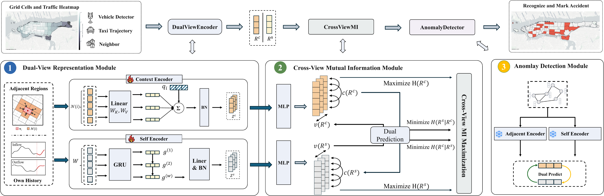

# MICON

Official PyTorch implementation of **MICON: A Mutual Information–Driven Contrastive Framework for Urban Anomaly Detection**.

MICON detects anomalous (region, time slot) instances in urban traffic without labels. Each instance is encoded from two disjoint views:

- **Self view**: a GRU over the region's own traffic window.
- **Context view**: attention over the windows of its geographic neighbors, with the region itself excluded.

Training maximizes a surrogate of the mutual information between the two latent representations. Dual prediction minimizes an upper bound on their conditional entropy, and variance–covariance penalties prevent collapse. The anomaly score of an instance is its dual prediction error. The score is high when the surroundings and the region's own history disagree.



## Repository structure

```text
MICON/
├── micon/
│   ├── model.py        # context / self encoders, projection heads, dual predictor
│   ├── losses.py       # L = λ_DP·L_DP + λ_VAR·L_VAR + λ_COV·L_COV
│   ├── data.py         # dataset loading, normalization, sliding windows
│   ├── metrics.py      # AUC, R@p, Hit@p
│   └── utils.py
├── configs/            # hyperparameters used in the paper, one file per dataset
├── data/               # NYC, Chicago and NYC-Simulated (see data/README.md)
├── checkpoints/        # trained models of the paper, 3 seeds per dataset
├── scripts/            # train all / evaluate all
├── train.py
└── test.py
```

## Installation

```bash
git clone https://github.com/RuckyWork/MICON.git
cd MICON
pip install -r requirements.txt
```

The code was tested with Python 3.10, PyTorch 2.6, NumPy 2.2 and scikit-learn 1.7. A GPU is recommended for NYC and NYC-Simulated. Chicago also trains on a CPU.

## Data

The three datasets are included in `data/` and need no preprocessing. All three use 30-minute slots and two features per region, taxi outflow and inflow.

| Dataset | Regions | Slots | Train / Val / Test slots | Test labels |
|---|---|---|---|---|
| NYC | 862 | 16,848 | 12,484 / 1,388 / 2,976 | 19 real events, 498 cells |
| Chicago | 77 | 11,664 | 8,688 / 1,488 / 1,488 | 22 real events, 314 cells |
| NYC-Simulated | 862 | 6,720 | 6,048 / 336 / 336 | 20 injected events, 80 cells |

- **NYC** uses the 2014 [NYC Yellow Taxi Trip Records](https://www.nyc.gov/site/tlc/about/tlc-trip-record-data.page) from January 15 to December 31. The flow comes from the release of [STGAN](https://github.com/dleyan/STGAN). The 862 regions are partitioned by the major road network, and two regions are adjacent if they share a road segment.
- **Chicago** uses the 2019 [Chicago Taxi Trip Records](https://data.cityofchicago.org/Transportation/Taxi-Trips-2019/h4cq-z3dy) from January 1 to August 31, over the 77 community areas. Each area is connected to its 8 nearest areas by centroid distance.
- **NYC-Simulated** follows the synthetic protocol of DA-UAD (Zhang et al., IJCAI 2019) on the NYC regions: a weekly template of the February 2014 flow, with multiplicative noise and weather drops. Two-hour events that scale the inflow and outflow by 3× are injected into the test week. The same kind of events is also injected, unlabeled, into 5% of the training region-days, so that the training data is contaminated.

Labels mark the anomalous (slot, region) cells and are used only for evaluation. The file format is described in [data/README.md](data/README.md), so you can also run MICON on your own data.

## Reproducing the paper results

Evaluate the released checkpoints, which are the models behind the paper tables:

```bash
python test.py --checkpoint checkpoints/nyc/seed*.pt
python test.py --checkpoint checkpoints/chicago/seed*.pt
python test.py --checkpoint checkpoints/nyc_sim/seed*.pt
# or: bash scripts/test_all.sh
```

Expected mean ± std over seeds 101, 202 and 303, in %:

| Dataset | AUC | R@1% | R@8% | R@20% |
|---|---|---|---|---|
| NYC | 92.87 ± 0.24 | 20.28 ± 1.75 | 67.14 ± 2.55 | 91.63 ± 0.58 |
| Chicago | 86.15 ± 1.01 | 5.73 ± 1.10 | 54.14 ± 1.15 | 81.63 ± 2.94 |
| NYC-Simulated | 96.07 ± 0.21 | 32.08 ± 5.77 | 84.17 ± 2.89 | 99.17 ± 0.72 |

On NYC-Simulated, the event hit ratio Hit@1/3/5/8/12/20% is 46.67 / 81.67 / 90.00 / 96.67 / 98.33 / 100.00.

The metrics are computed over all (test slot, region) cells, ranked globally by anomaly score:

- **R@p**: the share of labeled cells among the top p% of cells.
- **Hit@p**: the share of events that have at least one cell in the top p%.

## Training

```bash
python train.py --config configs/nyc.json --seed 101
# all datasets and seeds: bash scripts/train_all.sh
```

Training runs for 30 epochs, and the model of the last epoch is used. `runs/<dataset>/seed<seed>/` will contain:

- `model.pt`
- `history.json` (per-epoch losses)
- `scores.npy` (test scores of shape (T_test, N))
- `metrics.json`

Retrained models match the table above up to the usual seed-to-seed variation, because GPU kernels are non-deterministic.

The hyperparameters are in `configs/*.json`:

| Key | Meaning | NYC / NYC-Sim | Chicago |
|---|---|---|---|
| `window_size` | window length W (slots) | 12 | 12 |
| `num_neighbors` | neighbors K of the context view | 12 | 8 |
| `embed_dim` / `latent_dim` | view representation D / latent dimension C | 128 / 128 | 64 / 64 |
| `lambda_dp`, `lambda_var`, `lambda_cov` | loss weights | 1, 5, 1 | 1, 2, 1 |
| `lr`, `batch_size`, `epochs` | Adam learning rate, slots per batch, epochs | 1e-3, 50, 30 | 1e-3, 50, 30 |

## Citation

```bibtex
@article{micon,
  title  = {MICON: A Mutual Information--Driven Contrastive Framework for Urban Anomaly Detection},
  author = {TODO},
  year   = {2026}
}
```

## License

[MIT](LICENSE)
